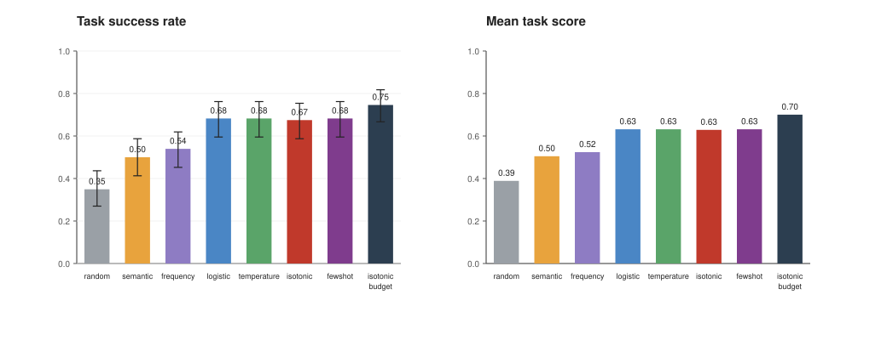

# SkillEvo

**Calibrated skill selection and tiered experience memory for spatiotemporal agents.**

SkillEvo is a self-contained, CPU-only benchmark and reference implementation for
reusing analysis skills across geospatial tasks. It ships a deterministic
seven-family scene generator, a skill-library induction pipeline, a calibrated
reuse discriminator, a two-tier experience memory, and a cross-task transfer
diagnosis.

The project asks a practical question: a retrieved skill can be lexically
similar to a task and still be unusable because its input regime, spectral
mechanism, or target semantics are incompatible. SkillEvo treats reuse as a
probabilistic decision rather than a similarity lookup.

## Highlights

- **Calibrated skill selector.** A small logistic discriminator predicts whether
  a historical skill will succeed on a new task. It combines description
  retrieval with structural compatibility (target, input kind, spectral
  mechanism, bands). Isotonic regression calibrates the output probability.
- **Tiered experience memory.** Recent outcomes stay in a short-term cache;
  long-term memory consolidates them with deduplication and bounded compression.
- **Cross-task transfer diagnosis.** A compatibility-aware Beta-binomial score
  is estimated from a small target probe split. Skills with weak structural and
  empirical support are blocked before execution.
- **Deterministic benchmark.** Seven task families, controlled scene changes,
  fixed seeds, no GPU, and no third-party Python dependencies.

## Benchmark

Each task is a 32 x 32 pixel, six-band scene with a hidden thematic target.
Families cover single-date and bi-temporal analysis:

| Family | Input | Target | Metric | Acceptance |
|---|---|---|---|---|
| Land cover | single | six classes | overall accuracy | 0.78 |
| Crop | single | crop / non-crop | F1 | 0.55 |
| Water | single | water | F1 | 0.65 |
| Flood | single | post-event water | F1 | 0.60 |
| Change | two dates | any change | F1 | 0.40 |
| Urban | two dates | new urban | F1 | 0.45 |
| Burn | two dates | burn scar | F1 | 0.50 |

Scenes contain class-specific spectra, contiguous land cover, agricultural
fields, seasonal illumination, sensor gain, texture, noise, optional clouds, and
controlled bi-temporal changes (urban expansion, deforestation, rotation,
flooding, fire). The same specification always produces the same scene.

A **skill** is a complete analysis recipe built from primitives such as
`index`, `temporal_diff`, `spectral_change`, `threshold`, `classify`, `smooth`,
`remove_small`, and `fill_holes`. The library is induced from reference
solutions and deduplicated by canonical signature; a typical run has about 20
skills.

## Results

Three seeds, 70 source training tasks per seed, and 126 target test tasks:

| Method | Success | Score | AUROC | Brier | ECE |
|---|---:|---:|---:|---:|---:|
| Random candidate | 0.349 | 0.389 | 0.495 | 0.334 | 0.284 |
| Description embedding | 0.500 | 0.505 | 0.666 | 0.233 | 0.152 |
| Frequency prior | 0.540 | 0.524 | 0.509 | 0.246 | 0.138 |
| Logistic, uncalibrated | 0.683 | 0.632 | 0.842 | 0.164 | 0.120 |
| + temperature scaling | 0.683 | 0.632 | 0.842 | 0.165 | 0.105 |
| + isotonic calibration | 0.675 | 0.629 | 0.842 | 0.156 | 0.063 |
| + target-dev calibration | 0.683 | 0.632 | 0.841 | 0.157 | 0.087 |
| Budgeted retry (3) | 0.746 | 0.701 | 0.842 | 0.156 | 0.063 |
| Oracle candidate bound | 0.802 | 0.753 | - | - | - |

The calibrated selector improves top-1 success by 17.5 percentage points over
description retrieval (McNemar p < 0.001) and mean task score by 0.124
(permutation p = 0.0002). Ranking quality improves from AUROC 0.666 to 0.842;
Brier score falls from 0.233 to 0.156 and ECE from 0.120 to 0.063 after
isotonic calibration.

Transfer gating raises success from 0.675 to 0.698 and lowers negative transfer
from 0.056 to 0.048. Tiered memory keeps success essentially flat (0.774) while
improving calibration over a no-memory agent (ECE 0.232 to about 0.12) and
reducing the retained experience footprint by 5.7x relative to flat memory.



## Quick start

Python 3.11 or newer. No third-party runtime dependencies.

```bash
python -m skillevo experiment --seeds 0,1,2 --output experiments
python -m skillevo report
python -m unittest discover -s tests
```

The experiment takes about 5.5 minutes on a laptop CPU. It writes
`experiments/results.json`, CSV tables, and a generated report. The report
command rebuilds `experiments/REPORT.md` and the SVG figures.

## How it works

### Skill selection

For a candidate skill and task, the selector uses:

- retrieval similarity and rank from a hashed description embedding;
- structural compatibility: target match, source-family match, input-kind
  match, spectral-mechanism match, band coverage, adaptivity, and cost;
- optional memory features: Beta-smoothed success and utility, recency,
  coverage, duplicate rate, novelty, and family-conditioned success.

The default model is an L2-regularised logistic regression fitted with IRLS.
A post-hoc calibrator is fitted on held-out source tasks: temperature scaling
or isotonic regression.

### Tiered memory

- **Short-term:** the last 24 outcomes, verbatim.
- **Long-term:** consolidated records with bounded capacity. `tiered` trims old
  records, `tiered_dedup` collapses duplicate outcome buckets, and `full` also
  prunes low-utility records during consolidation.

The stream experiment is prequential: select a skill, observe the result, then
ingest the outcome.

### Transfer diagnosis

For a skill and target family, the agent runs a small probe split of target
development tasks. Positive utility counts feed a Beta posterior whose prior is
set by structural compatibility. The transferability score combines the
posterior mean with normalized probe utility. Skills are marked `blocked`,
`uncertain`, or `transferable`; blocked skills are removed before reranking.

## Repository layout

```text
skillevo/        benchmark, selector, memory, transfer diagnosis, CLI
tests/           unit and smoke tests
docs/            design, benchmark, and reproducibility notes
experiments/     committed results, report, tables, and SVG figures
```

Start with [docs/DESIGN.md](docs/DESIGN.md), [docs/BENCHMARK.md](docs/BENCHMARK.md),
and [docs/REPRODUCIBILITY.md](docs/REPRODUCIBILITY.md). The generated results are
in [experiments/REPORT.md](experiments/REPORT.md).

## Scope and limitations

The benchmark is synthetic and diagnostic. It is not a remote-sensing
leaderboard and does not establish performance on operational land-cover or
change-detection systems. Scenes are small, there is no real sensor noise,
terrain, or co-registration error, and skills are deterministic programs rather
than free-form plans.

The feature ablation is deliberately reported: structural compatibility carries
most of the static selection signal, while historical outcome features mainly
help calibration in the streaming setting. Gating can isolate non-transferable
skills, but it cannot create a transferable skill that is absent from the
library.

## License

MIT. See [LICENSE](LICENSE).
