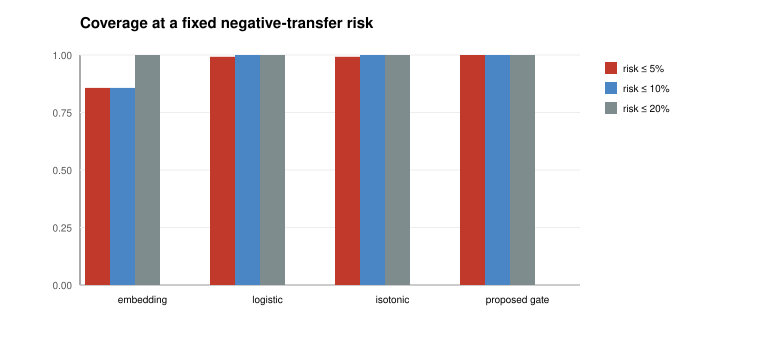

# SkillEvo: Calibrated Skill Selection and Tiered Memory for Tool-Using Agents

SkillEvo is a small Python package and benchmark for reusing analysis skills in
tool-using agents. It includes a deterministic spatiotemporal case study, a
calibrated skill-reuse score, tiered experience memory, and a transfer gate.

The central question is whether a retrieved skill is safe to reuse. SkillEvo
treats this as a decision problem: commit to a skill or fall back to a generic
baseline.

## Quick start

Python 3.11 or newer. No third-party runtime dependencies.

```bash
python -m skillevo experiment --seeds 0,1,2 --output experiments
python -m skillevo report
python -m unittest discover -s tests
```

The experiment takes about 5.5 minutes on a laptop CPU. It writes
`experiments/results.json`, CSV tables, and `experiments/REPORT.md`. The report
command rebuilds the Markdown report and SVG figures.

## What is included

- `skillevo/raster.py`: deterministic 32 x 32, six-band scene generator
- `skillevo/ops.py`: indices, thresholds, filters, and task grading
- `skillevo/tasks.py`: seven task families and skill-library induction
- `skillevo/selector.py`: logistic reuse discriminator and calibrators
- `skillevo/memory.py`: short-term and long-term experience memory
- `skillevo/transfer.py`: Beta-binomial transfer diagnosis and gates
- `skillevo/risk.py`: risk-coverage analysis for commit/abstain decisions
- `skillevo/experiment.py`: three-seed experiment runner
- `skillevo/report.py`: Markdown and SVG report
- `tests/`: unit and end-to-end tests

The current case study has seven families: land cover, crop, water, flood,
change, urban, and burn. Tasks are solved by deterministic recipes built from
spectral indices, thresholds, classifiers, and spatial filters. A run uses about
20 skills.

## Results

Three seeds and 126 target test tasks:

| Method | Success | Score | AUROC | Brier | ECE |
|---|---:|---:|---:|---:|---:|
| Description embedding | 0.500 | 0.505 | 0.666 | 0.233 | 0.152 |
| Frequency prior | 0.540 | 0.524 | 0.509 | 0.246 | 0.138 |
| Logistic, uncalibrated | 0.683 | 0.632 | 0.842 | 0.164 | 0.120 |
| + temperature scaling | 0.683 | 0.632 | 0.842 | 0.165 | 0.105 |
| + isotonic calibration | 0.675 | 0.629 | 0.842 | 0.156 | 0.063 |
| Budgeted retry (3) | 0.746 | 0.701 | 0.842 | 0.156 | 0.063 |
| Oracle candidate bound | 0.802 | 0.753 | - | - | - |

At a 5% negative-transfer risk, the calibrated gate commits to 100% of tasks,
versus 86% for description retrieval. The transfer gate raises success from
0.675 to 0.698 and lowers negative transfer from 0.056 to 0.048.



Tiered memory keeps success flat while reducing calibration error from 0.232
(no memory) to about 0.12 and using about 5.7x less storage than flat memory.

## Notes

- The benchmark is synthetic and diagnostic. It is not a remote-sensing
  leaderboard and does not establish operational accuracy.
- Structural compatibility carries most of the static selection signal.
  Historical memory mainly improves calibration and storage.
- Skills are deterministic programs. There is no LLM planner in the loop.
- Gating can block non-transferable skills, but it cannot create a skill that is
  absent from the library.

## Documentation

- [docs/SKILLEVO.md](docs/SKILLEVO.md) · [中文](docs/SKILLEVO.zh-CN.md) — research overview, method, protocol, results, limitations
- [paper/](paper/) — manuscript draft (`skillevo.md` readable draft, `skillevo.tex` IEEEtran source)
- [docs/DESIGN.md](docs/DESIGN.md)
- [docs/BENCHMARK.md](docs/BENCHMARK.md)
- [docs/REPRODUCIBILITY.md](docs/REPRODUCIBILITY.md)
- [experiments/REPORT.md](experiments/REPORT.md)

## License

MIT. See [LICENSE](LICENSE).
