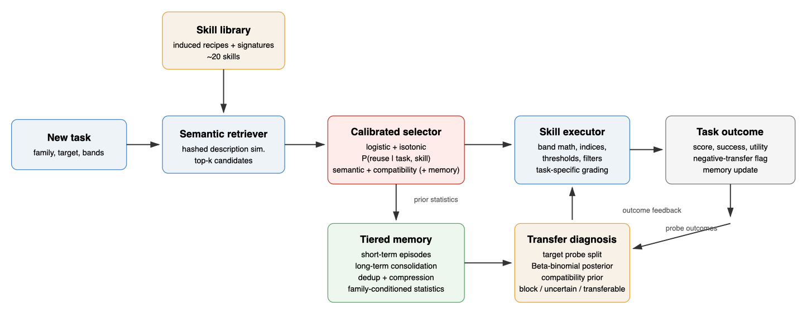
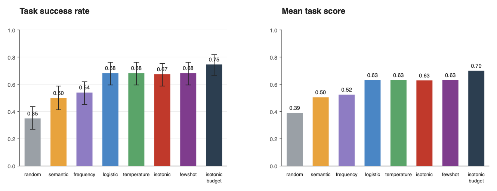
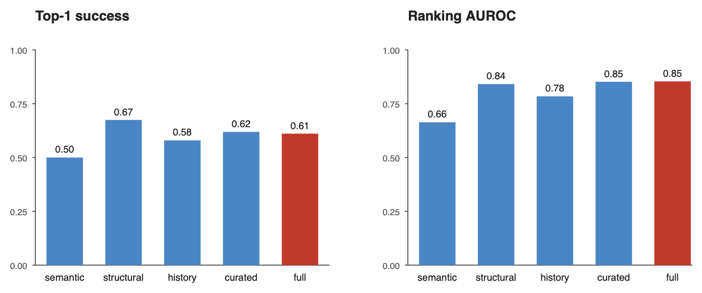
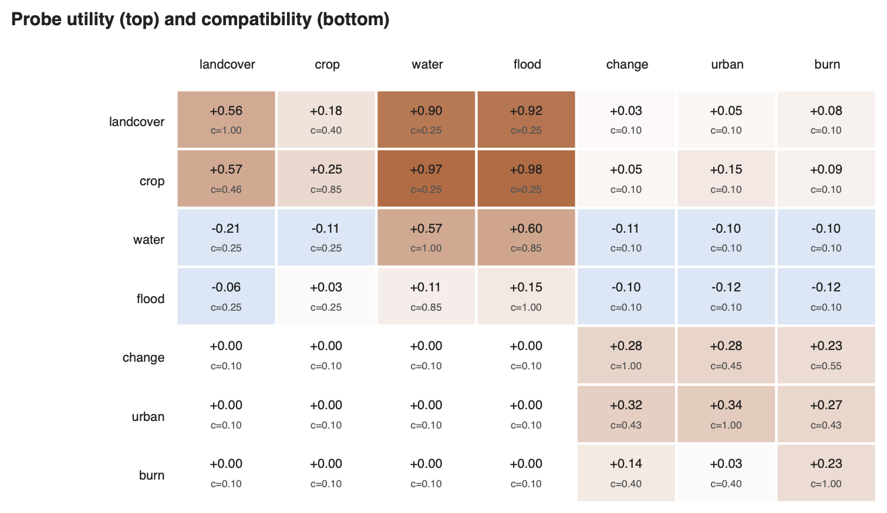
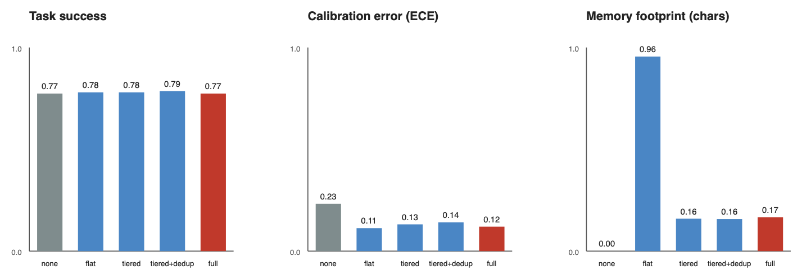

# SkillEvo: Calibrated Skill Selection and Tiered Experience Memory for Cross-Task Transfer in Spatiotemporal Agents

**Jiabei Zheng**  
Independent Researcher

*Manuscript prepared for the IEEE Journal of Selected Topics in Applied Earth Observations and Remote Sensing (JSTARS).*

## Abstract

Spatiotemporal agents increasingly rely on libraries of reusable analysis procedures (“skills”) induced from earlier remote-sensing workflows. The central question is not only how to retrieve a skill, but whether a retrieved skill will actually be reusable on a new task. Description embeddings answer the first question and are frequently used as a proxy for the second. We show that this proxy is brittle: lexically similar recipes can encode incompatible spectral mechanisms, input cardinality, or target semantics. We present SkillEvo, a module that combines a small calibrated reuse discriminator, a two-tier experience memory, and a transferability diagnosis for cross-task skill gating. The discriminator predicts the probability that a historical skill will succeed on a new task from retrieval and structural compatibility, with an optional family-conditioned memory variant; isotonic regression calibrates its probabilities on held-out tasks. The memory keeps recent episodes verbatim and consolidates long-term experience through deduplication and bounded compression. The transfer diagnosis estimates a Beta-binomial posterior over positive transfer on a small target probe split and blocks skills with weak structural and empirical support. On a controlled seven-family spatiotemporal benchmark, the calibrated selector raises top-1 success from 0.500 (description embedding) to 0.675 and mean task score from 0.505 to 0.629, while improving AUROC from 0.666 to 0.842 and reducing expected calibration error from 0.152 to 0.063. Transfer gating raises success to 0.698 and reduces negative transfer from 0.056 to 0.048. Tiered memory preserves success while reducing the retained experience footprint by 5.7× relative to flat memory and substantially improving calibration over a no-memory agent. We report a feature ablation showing that structural compatibility carries most of the selection signal in this benchmark; historical statistics mainly improve calibration and enable bounded memory. The benchmark and code are released for reproduction.

**Index Terms**—skill selection, experience memory, calibration, transfer diagnosis, spatiotemporal agents, remote sensing workflows.

## 1. Introduction

Remote-sensing analysis is increasingly assembled from reusable procedures: compute an index, threshold it, remove small components, fit a classifier on reference pixels, or compare two dates. Agents that solve such tasks can accumulate these procedures as a **skill library** and reuse them on later tasks [@voyager; @expel; @awm]. Reuse is attractive because it saves exploration and encodes expert parameter choices. It is also risky: a water extractor applied to a change-detection task may produce a plausible map with the wrong semantics, and a single-date classifier cannot exploit bi-temporal evidence. The resulting **negative transfer** is often invisible to retrieval scores.

Most agent memory and skill-selection systems rank candidates by embedding similarity to a task description [@rag; @voyager; @memorybank]. This is a reasonable recall mechanism but a weak decision rule. Embeddings conflate surface vocabulary with mechanism: “water extraction from NDWI” and “flood mapping from NDWI” are nearly identical in text, while “change detection with spectral distance” and “land-cover classification” may share many words yet require different inputs and outputs. Retrieval also ignores historical outcomes: a skill that repeatedly failed on a family should be down-ranked even if its description matches.

This paper asks three questions.

1. Can a small, calibrated discriminator predict skill reusability better than description similarity, and can its probabilities be trusted?
2. Can a two-tier memory retain the benefits of experience while keeping storage bounded and calibration stable?
3. Can a transferability score estimated from a few target probes isolate non-transferable skills and reduce negative transfer?

We answer them with **SkillEvo**, outlined in Figure 1. A semantic retriever proposes candidates from a deduplicated skill library. A calibrated logistic discriminator reranks them using retrieval and structural compatibility; a memory-enabled variant adds family-conditioned outcome statistics. A tiered memory supplies short-term and long-term evidence and is updated after each outcome. A transfer diagnosis runs each candidate on a small target development split, combines probe utility with a structural prior in a Beta-binomial score, and gates blocked skills before reranking.



The contributions are:

- **A calibrated skill-reuse discriminator.** It predicts `P(reuse | task, skill)` and is calibrated post hoc with temperature scaling or isotonic regression. On the benchmark it improves top-1 success by 17.5 percentage points over description retrieval (McNemar p < 0.001) and reduces ECE from 0.152 to 0.063.
- **A tiered experience memory.** Short-term verbatim episodes and long-term deduplicated/compressed records preserve success while shrinking retained experience by 5.7× relative to flat memory. Memory-enabled agents reduce ECE from 0.232 to about 0.12 in a prequential stream.
- **A cross-task transfer diagnosis.** A compatibility-aware Beta-binomial score blocks non-transferable skills, raises success from 0.675 to 0.698, and lowers negative transfer from 0.056 to 0.048. The transferability matrix exposes interpretable block structure, e.g., land-cover classifiers transfer to water/flood but not to change/urban/burn.
- **A controlled diagnostic benchmark and full reproduction package.** Seven spatiotemporal families, deterministic scenes, induced skill libraries, calibrated metrics, bootstrap intervals, paired tests, and a dependency-free implementation.

We are explicit about scope. The benchmark is synthetic and small. It is designed to isolate selection and transfer effects, not to establish state-of-the-art land-cover or change-detection accuracy. The feature ablation shows that structural compatibility alone is competitive with the full selector; we report this because it changes how the method should be used. SkillEvo is a diagnostic and a design pattern, not a claim of production readiness.

## 2. Related Work

**Skill libraries and agent memory.** Voyager [@voyager] stores executable code skills and retrieves them by description; ExpeL [@expel] extracts insights from success and failure trajectories; Reflexion [@reflexion] keeps verbal reflections; Agent Workflow Memory [@awm] induces reusable workflows. MemoryBank [@memorybank] and MemGPT [@memgpt] add long-term memory with summarization and paging. Generative Agents [@park] use a memory stream with recency, importance, and relevance. These systems establish that reuse and memory help, but they evaluate end-to-end with an LLM and rarely calibrate the reuse decision or diagnose cross-family transfer.

**Retrieval and reranking.** Dense retrieval [@dpr; @rag] and late interaction [@colbert] rank passages by representation similarity. Skill selection is a retrieval problem with an important difference: the ranked item is executable, and its usefulness depends on input requirements and output semantics that a description may omit. Our discriminator is a lightweight reranker in the spirit of learning-to-rank, but trained on observed skill outcomes rather than query-document relevance.

**Calibration.** Modern classifiers are often overconfident [@guo]. Temperature scaling, Platt scaling, isotonic regression, and beta calibration are standard post-hoc fixes [@platt; @zadrozny; @niculescu; @kull]. We use temperature and isotonic calibration because they are cheap and interpretable. Calibration matters here because the score is used as a probability of reuse, and because downstream gating and memory updates depend on it.

**Transfer and negative transfer.** Transfer learning studies when source knowledge helps a target task [@pan; @zhuang]. Negative transfer is usually diagnosed after training. Our setting is episodic: a small number of target probes is available before the agent commits, so we estimate transferability online with a Beta-binomial posterior rather than retraining a model.

**Spatiotemporal and remote-sensing agents.** Deep learning has become standard for land-cover mapping and change detection [@zhu; @ma; @chencd]. Foundation models such as SpectralGPT [@spectralgpt], RemoteCLIP [@remoteclip], and SkySense [@skysense] provide general representations. Our benchmark deliberately avoids heavy representations: tasks are solved by explicit spectral and spatial operations so that skill reuse, not representation quality, is the experimental variable. The interface is compatible with real GeoTIFF data and with stronger perception backends.

## 3. Problem Formulation

Let `L = {s_1, ..., s_n}` be a skill library. A skill `s` is a macro `(o_1, ..., o_m)` of primitive operations with a canonical signature, an input kind (single-date or bi-temporal), required bands, target labels, and provenance. A task `t` has a family, a target, an input kind, band metadata, and a hidden ground-truth map. Executing `s` on `t` yields a prediction and a task metric `q(s,t) ∈ [0,1]` (overall accuracy for multiclass maps, F1 for binary maps).

A task is **solved** if `q(s,t) ≥ τ_f`, where `τ_f` is a family-specific acceptance threshold fixed before evaluation. The reuse label is

```
y(s,t) = 1[ q(s,t) ≥ τ_f ].
```

Given a candidate set `C(t)` returned by a retriever, the selector estimates `p(s,t) = P(y=1 | t, s, M)`, where `M` is the current memory. The agent executes the highest-scoring candidate (or retries up to a budget `B`). We evaluate both top-1 and budgeted selection.

The central comparison is between ranking by `p(s,t)` and ranking by description similarity `sim(φ(t), ψ(s))`, where `φ` and `ψ` are hashed text embeddings. Both use the same candidate pool, so the comparison isolates the reranker.

## 4. Method

### 4.1 Skill induction and library

Source tasks are solved by reference recipes. A recipe is a sequence of primitives such as `index(ndwi)`, `threshold(otsu)`, `spectral_change`, `classify(nearest_centroid)`, `smooth(majority)`, `remove_small`, and `fill_holes`. The reference recipe and its parameter variants are canonicalized; identical signatures are merged. A typical run yields about 20 skills. The library also stores provenance (source family and tasks), input requirements, targets, and a natural-language description used only for retrieval.

The generic fallback is a fixed NDVI threshold without cleanup. It is intentionally weak, so improvements measure the value of historical skills rather than the strength of a hand-coded baseline.

### 4.2 Calibrated reuse discriminator

The discriminator is an L2-regularised logistic model fitted by iteratively reweighted least squares (IRLS) with class-balanced weights. Features fall into three groups.

**Retrieval.** Cosine similarity between hashed description embeddings and its rank among candidates.

**Compatibility.** Target match, source-family match, input-kind match, spectral-mechanism match (e.g., NDWI for water, spectral distance for change, nearest-centroid for land cover), band coverage, adaptivity, and operation cost.

**Experience (optional memory variant).** Beta-smoothed success rate, mean utility, utility standard deviation, evidence strength, recency, family coverage, duplicate rate, novelty, recent success, and family-conditioned success from memory. The default selector uses the structural set; the memory variant is used for the streaming experiment.

The model outputs a logit; a post-hoc calibrator maps it to a probability. Temperature scaling learns one scalar `T` by minimizing negative log-likelihood on a held-out source split:

```
p_T = σ( logit / T ).
```

Isotonic regression fits a monotone step function by pool-adjacent-violators. We report both; the main model uses isotonic calibration. A variant calibrated on target development tasks measures few-shot adaptation.

### 4.3 Tiered experience memory

Memory receives an outcome record after each execution: skill, task family, target, success, utility, and a timestamp. The short-term tier keeps the last `W = 24` records verbatim. The long-term tier applies one of four policies:

- `tiered`: bounded FIFO truncation;
- `tiered_dedup`: collapse records with the same `(skill, family, target, success, utility bucket)`;
- `full`: dedup plus utility-aware pruning during consolidation.

Statistics are computed from the long-term store, with the short-term store supplying recency and recent-success features. The design separates **episodic evidence** (recent, high-resolution) from **semantic evidence** (consolidated, bounded), following the distinction between fast and slow memory in agent architectures [@memgpt; @park].

### 4.4 Cross-task transfer diagnosis

For a candidate skill and target family, the agent runs the skill on a small probe split of target development tasks. Let `u_i` be the utility delta on probe `i` (task score minus the generic baseline), `n` the number of probes, and `k` the number of positive deltas. A Beta posterior is

```
α = 1 + 2c + k,   β = 1 + 2(1-c) + (n-k),
```

where `c` is a structural compatibility score:

```
c = 0.30·target_match + 0.15·family_match + 0.15·input_match
  + 0.30·mechanism_match + 0.10·band_coverage.
```

The transferability score combines compatibility and normalized probe utility:

```
r = 0.60c + 0.40·clip((ū + 0.10)/0.60, 0, 1).
```

A skill is **blocked** if `c < 0.35` and `ū < 0.25`; **transferable** if strong probe evidence (`ū ≥ 0.25`, positive rate ≥ 0.75) overrides a weak prior, or if structural compatibility and positive utility agree, or if partial compatibility (`c ≥ 0.35`) meets positive utility (`ū > 0.10`); otherwise it is **uncertain**. Blocked skills are removed before reranking; uncertain skills are down-weighted. The thresholds are fixed on development data and not tuned on the test split.

## 5. Benchmark and Protocol

### 5.1 Scenes and tasks

Each scene is 32×32 pixels with six bands (blue, green, red, NIR, SWIR1, SWIR2). Class-specific spectra are combined with spatially contiguous land cover, agricultural fields, seasonal illumination, sensor gain, texture, noise, and optional cloud contamination. Bi-temporal scenes apply controlled changes: urban expansion, deforestation, crop rotation, flooding, or fire. Task families are summarized in Table I.

**Table I. Task families.**

| Family | Input | Target | Metric | Threshold |
|---|---|---|---|---|
| Land cover | single | six classes | OA | 0.78 |
| Crop | single | crop / non-crop | F1 | 0.55 |
| Water | single | water | F1 | 0.65 |
| Flood | single | post-event water | F1 | 0.60 |
| Change | two dates | any change | F1 | 0.40 |
| Urban | two dates | new urban | F1 | 0.45 |
| Burn | two dates | burn scar | F1 | 0.50 |

### 5.2 Splits and metrics

We use three seeds. Per seed, 70 source training tasks (10 per family), 28 source validation tasks, 56 target development tasks (8 per family), 42 target test tasks (6 per family), and 56 stream tasks. Source and target tasks use disjoint scene seeds and parameter combinations.

The candidate pool is the top eight skills by description embedding. Main results use top-1 selection; a budgeted variant retries up to three candidates. We report success, mean task score, negative-transfer rate, AUROC, AUPRC, Brier score, NLL, ECE, precision at one, and NDCG at five. Confidence intervals use 2,000 task-level bootstrap resamples. Paired success uses an exact McNemar test; paired scores use a 5,000-draw sign-flip permutation test.

Negative transfer is counted when the selected skill falls back because it is incompatible, or when its utility is below −0.02. This is deliberately strict: a skill that is merely weaker than the best candidate but still improves on the generic baseline is not labeled harmful.

## 6. Results

### 6.1 Skill selection and calibration

Table II reports the main comparison. Description retrieval solves 0.500 of target tasks. The calibrated selector solves 0.675, an improvement of 17.5 percentage points (McNemar p < 0.001), and raises mean score from 0.505 to 0.629 (permutation p = 0.0002). Ranking quality increases from AUROC 0.666 to 0.842 and AUPRC from 0.547 to 0.661. Brier score falls from 0.233 to 0.156.

**Table II. Main results (three seeds, 126 target tasks).**

| Method | Success | Score | Neg. transfer | AUROC | AUPRC | Brier | NLL | ECE | P@1 |
|---|---:|---:|---:|---:|---:|---:|---:|---:|---:|
| Random | 0.349 | 0.389 | 0.294 | 0.495 | 0.369 | 0.334 | 1.007 | 0.284 | 0.333 |
| Embedding | 0.500 | 0.505 | 0.183 | 0.666 | 0.547 | 0.233 | 1.127 | 0.152 | 0.500 |
| Frequency | 0.540 | 0.524 | 0.198 | 0.509 | 0.380 | 0.246 | 0.686 | 0.138 | 0.540 |
| Logistic | 0.683 | 0.632 | 0.056 | 0.842 | 0.655 | 0.164 | 0.491 | 0.120 | 0.683 |
| + temperature | 0.683 | 0.632 | 0.056 | 0.842 | 0.655 | 0.165 | 0.494 | 0.105 | 0.683 |
| + isotonic | 0.675 | 0.629 | 0.056 | 0.842 | 0.661 | 0.156 | 0.629 | 0.063 | 0.675 |
| + target-dev cal. | 0.683 | 0.632 | 0.056 | 0.841 | 0.654 | 0.157 | 0.612 | 0.087 | 0.683 |
| Budgeted retry (3) | 0.746 | 0.701 | 0.286 | 0.842 | 0.661 | 0.156 | 0.629 | 0.063 | 0.675 |
| Oracle bound | 0.802 | 0.753 | 0.000 | - | - | - | - | - | - |



The uncalibrated logistic model is already discriminative (AUROC 0.842) but overconfident (ECE 0.120). Temperature scaling modestly improves ECE to 0.105; isotonic calibration cuts it to 0.063 and Brier to 0.156, at a small cost in top-1 success (0.675 vs 0.683). Target-development calibration reaches ECE 0.087, suggesting that a handful of labelled target tasks can substitute for source validation data. The budgeted retry closes most of the gap to the oracle bound (0.746 vs 0.802), at the cost of more attempts and a higher negative-transfer rate.

### 6.2 Feature ablation

Table III isolates feature groups. The structural set is the default discriminator and reaches 0.675 top-1 success. Adding historical outcome features lowers static top-1 success to 0.611; history-only features reach 0.579. The structural set also has the best ECE (0.063).

**Table III. Feature ablation (isotonic calibration).**

| Feature set | Success | Score | AUROC | ECE |
|---|---:|---:|---:|---:|
| Semantic only | 0.500 | 0.504 | 0.664 | 0.073 |
| Structural | 0.675 | 0.629 | 0.842 | 0.063 |
| History | 0.579 | 0.586 | 0.784 | 0.073 |
| Curated | 0.619 | 0.613 | 0.852 | 0.070 |
| Full | 0.611 | 0.610 | 0.854 | 0.077 |



This is the most important negative result in the paper. On this benchmark, the structural features (target, input kind, mechanism, bands) do most of the work; historical outcome statistics are noisy because the source corpus is small and contains many failed trials. History features still improve calibration in the streaming setting (§6.4), where they are updated online, but they do not improve static top-1 selection. We therefore use the structural set for the default selector and treat history as a calibration and memory mechanism, not as a substitute for structural validation.

### 6.3 Cross-task transfer diagnosis

Table IV reports gate strategies. The proposed gate raises success from 0.675 to 0.698 and lowers negative transfer from 0.056 to 0.048. A semantic compatibility gate is too aggressive (0.579): it blocks cross-family skills that empirical probes would have retained. Outcome-only gating does not help: probe utility alone is not sufficient because a weak skill can improve on a very weak baseline.

**Table IV. Transfer gating (top-1).**

| Strategy | Success | Score | Negative transfer |
|---|---:|---:|---:|
| No gate | 0.675 | 0.629 | 0.056 |
| Semantic gate | 0.579 | 0.559 | 0.103 |
| Outcome gate | 0.675 | 0.629 | 0.056 |
| Proposed | 0.698 | 0.647 | 0.048 |

The transferability matrix (Figure 4) exposes a block structure. Land-cover and crop classifiers transfer strongly to water and flood (probe utility 0.90–0.98) because the task supplies binary reference pixels and the classifier adapts. They do not transfer to change, urban, or burn (0.03–0.15). Water skills transfer to flood (0.60) but not to change (−0.11). Change and burn detectors transfer to each other (0.28/0.23). These patterns are consistent with the underlying mechanisms: single-date spectral classifiers and bi-temporal change detectors are different input regimes.



Pair-level case studies clarify the trade-off. On land-cover → change, all source skills are blocked; the un-gated agent occasionally succeeds by luck (0.06) but incurs frequent negative transfer, while the gated agent falls back to the generic baseline and succeeds on 0.00. The gate is doing what it claims—isolating non-transferable skills—but it cannot create a transferable skill that is not in the library. On water → flood, all skills are retained and success is 1.00. On land-cover → crop, partial compatibility keeps the classifiers and success is 0.61. On crop → land cover, success is 0.94. The diagnosis is most useful when the library contains a mixture of transferable and non-transferable recipes, and least useful when an entire source family is non-transferable.

### 6.4 Tiered memory

Table V reports the prequential stream. Success is essentially flat across memory modes (0.774–0.786), but calibration improves sharply. No memory gives ECE 0.232; flat memory gives 0.113; tiered gives 0.131; full gives 0.120. The flat store keeps 616 records / 57,315 characters; the full store keeps 109 records / 9,987 characters, a 5.7× reduction. Deduplication keeps 104 records / 9,428 characters. The full store is not the best-calibrated mode on this stream, but it is within 0.007 ECE of flat memory at a fraction of the footprint.

**Table V. Prequential memory stream.**

| Mode | Success | Score | ECE | Records | Characters | Duplicate ratio |
|---|---:|---:|---:|---:|---:|---:|
| None | 0.774 | 0.709 | 0.232 | 0 | 0 | 0.000 |
| Flat | 0.780 | 0.699 | 0.113 | 616 | 57,315 | 0.000 |
| Tiered | 0.780 | 0.703 | 0.131 | 106 | 9,535 | 0.000 |
| Tiered + dedup | 0.786 | 0.707 | 0.141 | 104 | 9,428 | 0.500 |
| Full | 0.774 | 0.705 | 0.120 | 109 | 9,987 | 0.492 |



The result supports a modest claim: tiered memory is a **resource-efficient calibration mechanism**, not a magic source of task success. It preserves the success of flat memory while shrinking storage by an order of magnitude and keeping ECE far below the no-memory agent. In a real deployment, the footprint reduction matters for long-running agents and for on-device operation.

### 6.5 Statistical tests

Isotonic selection versus embedding retrieval: success +0.175 (McNemar p < 0.001), score +0.124 (permutation p = 0.0002). Versus random: success +0.325 (p < 0.001), score +0.240 (p < 0.001). The budgeted variant versus top-1 is not tested here because it changes the action budget; it is reported as an operating point. The gate's success gain (+0.023) is smaller and should be read together with the negative-transfer reduction.

## 7. Discussion

**Why calibration helps.** The selector's ranking is already good before calibration (AUROC 0.842). Calibration matters because the score is consumed as a probability by the gate and by memory updates. A well-calibrated 0.4 should mean “reuse succeeds about 40% of the time,” not “the logit is above zero.” Isotonic regression achieves this on the target distribution; temperature scaling is too rigid when the validation split is small.

**Why structural features dominate.** The benchmark's skills have explicit input requirements and spectral mechanisms. A target/input/mechanism mismatch is a hard constraint, not a subtle statistical signal. A learned model with enough data could discover this, but with 70 source tasks the hand-designed compatibility features are more sample-efficient. This is a feature, not a bug: in real remote-sensing workflows, input requirements and target semantics are usually known and should be used.

**Why transfer diagnosis is needed even when structural features are strong.** Structural compatibility is a prior, not evidence. A land-cover classifier can look structurally incompatible with water yet work well because the water task supplies binary reference pixels. Conversely, two change detectors can look compatible yet fail on a new change type. Probe outcomes correct both errors. The Beta posterior makes the correction conservative: a skill with two positive probes is not declared transferable unless its structural prior is also reasonable, and a skill with strong evidence can override a weak prior.

**Implications for agent design.** Separate recall from commitment. Use embeddings for recall, structural checks for admissibility, calibration for probability, and a small probe budget for transfer. Keep recent episodes for adaptation and consolidated experience for scale. Do not expect memory to create skills that were never learned.

## 8. Limitations and Ethics

- **Synthetic benchmark.** Scenes are 32×32 and omit terrain, atmosphere, co-registration error, and real sensor noise. The results are diagnostic, not a remote-sensing leaderboard.
- **No LLM in the loop.** Skills are deterministic programs. An LLM planner would add flexibility and failure modes that this benchmark does not capture.
- **Small library and corpus.** About 20 skills and 70 source tasks per seed. The history features are data-starved; a larger corpus may change the ablation.
- **Threshold sensitivity.** Success thresholds are family-specific and fixed by the authors. Different thresholds would change absolute success rates, though the paired comparisons are less sensitive.
- **Probe budget.** Eight target development tasks per family are used for transfer diagnosis. This is a small sample; the posterior is conservative but still noisy.
- **No real-data experiment.** The GeoTIFF hook is provided but not evaluated. A real-data study is the natural next step.
- **Responsible use.** Remote-sensing maps can inform land-use, disaster response, and environmental policy. Skill reuse should be audited for mechanism mismatch, and predictions should not be used without domain validation.

## 9. Conclusion

SkillEvo treats skill reuse as a calibrated decision rather than a similarity lookup. A small discriminator with structural compatibility improves top-1 success by 17.5 points over description embeddings and cuts calibration error by more than half. Tiered memory preserves success while reducing the experience footprint by 5.7×. A compatibility-aware transfer diagnosis raises success by 2.3 points and reduces negative transfer. The benchmark also shows the limits of the approach: structural features dominate, history is mainly a calibration resource, and gating can only isolate non-transferable skills—not invent transferable ones. We release the benchmark, code, results, and reproduction commands to support follow-up work on real spatiotemporal data.

## Appendix A. Reproducibility

```bash
python -m venv .venv
source .venv/bin/activate
python -m pip install -r requirements.txt
python -m skillevo experiment --seeds 0,1,2 --output experiments
python -m skillevo report
python -m unittest discover -s tests -p 'test_skillevo_*.py'
```

The experiment is deterministic given the seeds. `experiments/results.json` contains every task-level record; `REPORT.md` contains the generated tables and figure links.

## Data and code availability

The benchmark, experiment runner, task-level results, and figure-generation code are included in this repository under `skillevo/` and `experiments/`. The experiment is deterministic for a fixed seed. No proprietary data are used. A DOI-archived release should be created before submission.

## Appendix B. Feature list

Retrieval: `semantic`, `semantic_rank`. Compatibility: `target_match`, `family_match`, `input_match`, `mechanism_match`, `band_coverage`, `adaptive`, `cost`. Experience: `history_success`, `history_utility`, `history_std`, `history_strength`, `history_recency`, `history_coverage`, `history_duplicates`, `novelty`, `history_recent`, `history_family_success`, `history_family_strength`. Interactions: `semantic_x_target`, `input_x_mechanism`, `success_x_target`. The ablation also includes constant/near-collinear features in the “full” set.

## References

1. G. Wang et al., “Voyager: An Open-Ended Embodied Agent with Large Language Models,” arXiv:2305.16291, 2023.
2. A. Zhao et al., “ExpeL: LLM Agents Are Experiential Learners,” AAAI, 2024.
3. Z. Z. Wang, J. Mao, G. Neubig, and D. Fried, “Agent Workflow Memory,” arXiv:2409.07429, 2024.
4. W. Zhong et al., “MemoryBank: Enhancing Large Language Models with Long-Term Memory,” AAAI, 2024.
5. C. Packer et al., “MemGPT: Towards LLMs as Operating Systems,” arXiv:2310.08560, 2023.
6. J. S. Park et al., “Generative Agents: Interactive Simulacra of Human Behavior,” UIST, 2023.
7. N. Shinn et al., “Reflexion: Language Agents with Verbal Reinforcement Learning,” NeurIPS, 2023.
8. V. Karpukhin et al., “Dense Passage Retrieval for Open-Domain Question Answering,” EMNLP, 2020.
9. P. Lewis et al., “Retrieval-Augmented Generation for Knowledge-Intensive NLP Tasks,” NeurIPS, 2020.
10. O. Khattab and M. Zaharia, “ColBERT: Efficient and Effective Passage Search via Contextualized Late Interaction over BERT,” SIGIR, 2020.
11. C. Guo, G. Pleiss, Y. Sun, and K. Q. Weinberger, “On Calibration of Modern Neural Networks,” ICML, 2017.
12. J. C. Platt, “Probabilistic Outputs for Support Vector Machines and Comparisons to Regularized Likelihood Methods,” in Advances in Large Margin Classifiers, MIT Press, 1999.
13. B. Zadrozny and C. Elkan, “Transforming Classifier Scores into Accurate Multiclass Probability Estimates,” KDD, 2002.
14. A. Niculescu-Mizil and R. Caruana, “Predicting Good Probabilities with Supervised Learning,” ICML, 2005.
15. M. Kull, T. Silva Filho, and P. Flach, “Beta Calibration: A Well-Founded and Easily Implemented Improvement on Logistic Calibration for Binary Classifiers,” AISTATS, 2017.
16. S. J. Pan and Q. Yang, “A Survey on Transfer Learning,” IEEE TKDE, vol. 22, no. 10, pp. 1345–1359, 2010.
17. F. Zhuang et al., “A Comprehensive Survey on Transfer Learning,” Proceedings of the IEEE, vol. 109, no. 1, pp. 43–76, 2021.
18. X. X. Zhu et al., “Deep Learning in Remote Sensing: A Comprehensive Review and List of Resources,” IEEE Geoscience and Remote Sensing Magazine, vol. 5, no. 4, pp. 8–36, 2017.
19. L. Ma et al., “Deep Learning in Remote Sensing Applications: A Meta-Analysis and Review,” ISPRS Journal of Photogrammetry and Remote Sensing, vol. 152, pp. 166–177, 2019.
20. H. Chen and Z. Shi, “A Spatial-Temporal Attention-Based Method and a New Dataset for Remote Sensing Image Change Detection,” Remote Sensing, vol. 12, no. 10, 1662, 2020.
21. D. Hong et al., “SpectralGPT: Spectral Remote Sensing Foundation Model,” IEEE TPAMI, vol. 46, no. 8, pp. 5227–5244, 2024.
22. F. Liu et al., “RemoteCLIP: A Vision Language Foundation Model for Remote Sensing,” IEEE TGRS, vol. 62, 5612216, 2024.
23. X. Guo et al., “SkySense: A Multi-Modal Remote Sensing Foundation Model Towards Universal Interpretation for Earth Observation Imagery,” CVPR, 2024.

BibTeX entries are in `refs.bib`.
